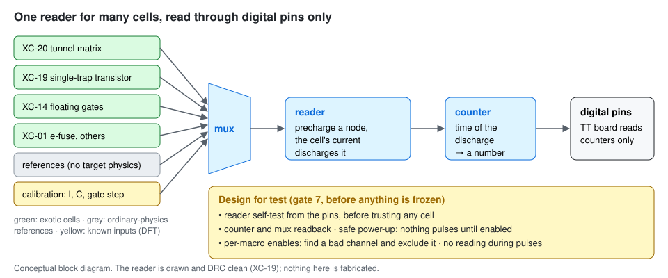

# What each cell would unlock

If a cell works in silicon, what could be built with it? Two directions for each: **next to standard cells** (a normal digital
Tiny Tapeout design that gains one new primitive) and **in a chip made of exotic cells** (where the unusual physics is the
point). Last update: 2026-11-16.

**Everything on this page is a possibility, not a result.** No cell has been fabricated. Each row depends on the result named
in the column *needs*; the evidence for each cell is in the [ranking](RANKING.md) and in [CLAIMS](CLAIMS.md). Nothing here is
used to rank cells: relevance is a judgement about what would follow, not evidence that it will.

## The shared instrument already is an architecture

Every cell is read the same way: the cell's current discharges a precharged node, and an on-chip counter times it. That makes
the reader a small **physics-to-digital converter**: any phenomenon that changes a current, a threshold or a capacitance
becomes a number on the digital pins. With a self-test path, calibration and per-channel enables
([PIPELINE](PIPELINE.md#gates-before-tapeout), gate 7), the same block can host many cells on one tile with few pins. If
nothing exotic works, this instrument plus the LOD matrix is still a useful process monitor for SKY130.

## Cell by cell

| Cell, if it works | Next to standard cells | In an exotic chip | Needs | Relevance |
|---|---|---|---|---|
| [XC-20](../cells/xc20_abutted_junction/PLAN.md) tunnel diode | A current reference that depends little on temperature (tunnelling is weakly activated); a leakage element that is drawn, not suffered | If negative resistance appears: oscillators and bistable pairs made of diodes, the tunnel-diode logic of the 1960s (Goto pair, `READING.md`) on a modern open PDK | Tunnelling at 0 gap (P1); negative resistance is a separate, open question | A device the open PDK does not offer, from a legal layout |
| [XC-19](../cells/xc19_single_trap/PLAN.md) single trap | A physical random number source for the digital logic (assessed as in NIST SP 800-90B); an ageing monitor | Arrays of single-defect sensors: a map of traps across a die, a single-charge detector | Discrete levels resolved (P2) | Watching one electron on a digital chip; the reader validates every other cell |
| [XC-14](../cells/xc14_antenna_write/PLAN.md) fab-written gate | A chip-age clock and a die-unique pattern written at birth, read by ordinary logic (anti-counterfeit, provenance) | A local oxide-thickness gauge across a die | Readable charge after anneal (P3) | Uses a step every chip goes through; SKY130 is the only TT window for it (A2) |
| [XC-01](../cells/xc01_m1_constriction/PLAN.md) → [XC-05](../cells/xc05_atomic_contact/PLAN.md) e-fuse | One-time-programmable bits for trim, configuration, keys or IDs, next to the logic that uses them | If the blow stops at a few atoms: few-channel conduction, a quantum transport experiment on a CMOS chip | A clean open, or a stable partial state (P8) | Suggested from the Tiny Tapeout side as useful (A6) |
| [XC-58](../cells/xc58_ktc_cell/PLAN.md) kT/C cell | A random source whose variance is set by physics; an on-chip meter of 1–30 fF capacitances | Self-characterisation of parasitics; noise thermometry (secondary, calibrated: still to assess) | Reader noise below kT/C (P7 open) | Turns the noise every designer fights into a measurement |
| [XC-62](../cells/xc62_proximity_fet/PLAN.md) printed transistors | Better timing and matching models for everyone using SKY130, through [Residual](../residual/README.md) | A map of what the fab's lithography correction leaves behind | Effect above mismatch with enough copies (Q7) | Useful to every designer even if nothing exotic works |
| [XC-52](../cells/xc52_spin_pair/PLAN.md), [XC-60](../cells/xc60_magnetodiode/PLAN.md), [XC-56](../cells/xc56_microcoil/PLAN.md) | A magnetometer with no magnetic material; an on-chip field source for self-test | Room-temperature spin readout of defects; magnetic links between blocks | Signal size (P6) and a clean even-in-field control (A7) | Spin physics in a commercial process |
| [XC-57](../cells/xc57_peltier_junction/PLAN.md) Peltier junction | Heat moved by current direction, read as a signal | Heat as a carrier of information between blocks | The odd-in-current part above Joule heating | Thermal design as a primitive |
| [XC-26](../cells/xc26_optical_link/PLAN.md), [XC-27](../cells/xc27_hole_arrays/PLAN.md) | An optical link inside the die: signalling without a wire | Optical structures in the metal stack | Substrate resistivity (P4) | Optics in a digital process |
| [XC-21](../cells/xc21_avalanche_emitter/PLAN.md) + [XC-53](../cells/xc53_hv_pump/PLAN.md) | A light emitter and, later, single-photon detection next to logic | Photon-counting arrays | High voltage on a tile (Q3) or another PDK (Q9) | Avalanche optics from 1.8 V |
| [XC-54](../cells/xc54_tin_superconductor/PLAN.md), [XC-30](../cells/xc30_mesoscopic/PLAN.md), [XC-61](../cells/xc61_freezeout_oscillator/PLAN.md) | Cryogenic CMOS control next to its own test structures | A bridge between classical CMOS and quantum devices | A cryostat | The classical-quantum bridge in an open process |
| LOD / [Residual](../residual/README.md) (already a run) | Netlists that keep the stress information Magic drops | — | Silicon following the model (P5) | Immediate value to every SKY130 user |

## Combinations worth thinking about

- **Provenance:** e-fuse ID (XC-01) + fab-written age clock (XC-14): who made the chip, and how long ago.
- **Physical randomness with a check:** single-trap noise (XC-19) next to kT/C noise (XC-58), read by the same reader: two
  independent physical sources, one discrete and one Gaussian, each the control of the other.
- **A reference that explains itself:** tunnel current (XC-20) with its ordinary-physics references (0.27, 0.54, 1.08 µm and
  no-junction cell) as a self-calibrating, temperature-aware current source.
- **A test chip for the process:** LOD matrix + printed transistors + Kelvin strips + the reader: a SKY130 process monitor that
  others can reuse.

## What a "purely exotic" chip would need

A chip without standard logic around the cells still needs the instrument: something to turn physics into numbers and get them
out. MISFIT's choice (PROPOSAL, architecture decision of 2026-11-16) is digital pins first, so even the most exotic tile keeps
the shared reader and counters. A chip on a specialised vehicle (bare die, light, cryostat, high voltage) is listed in the
catalogue's *Vehicle* column; none is planned yet.
